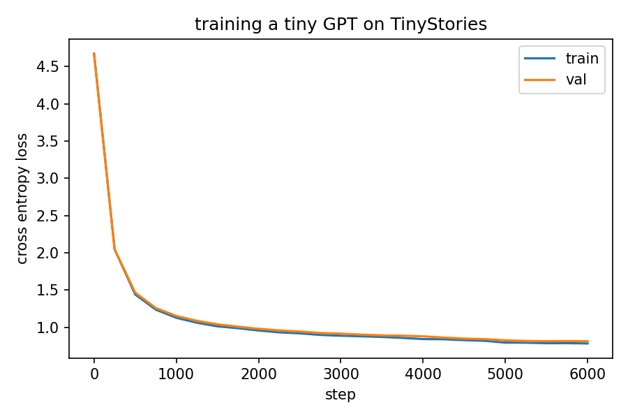

# HW3: Pretraining a Small Language Model from Scratch

CMPSC 448

We train a tiny character-level GPT on a dataset of children's stories, starting
from random weights, and then talk to it.

## Dataset

**TinyStories** (Eldan and Li, 2023), downloaded from HuggingFace:
https://huggingface.co/datasets/roneneldan/TinyStories

It's a collection of short stories that only use words a 3 to 4 year old would know.
That makes it a good fit for a really small model, because the model doesn't have to
learn a huge vocabulary or complicated grammar before its output starts making sense.

We only use the dataset's validation split (about 22k stories, roughly 18 MB of text).
The full training split is around 2 GB, which is way more than a model this size needs.
`get_data.py` does some light cleaning:

- curly quotes, long dashes and "..." are turned into plain ASCII
- any other non-ASCII character is removed, so the vocabulary stays small
- stories shorter than 100 characters are dropped
- stories are joined into one file with a blank line between them

Then `train.py` uses the first 90% of the text for training and keeps the last 10%
as a validation set that the model never trains on.

## Model

A decoder-only transformer (same basic idea as GPT), written from scratch in PyTorch
in `model.py`. No pretrained weights anywhere, everything starts random.

| setting | value |
|---|---|
| tokens | single characters (vocab = every character in the data, about 90) |
| context length | 256 characters |
| layers | 4 transformer blocks |
| attention heads | 6 |
| embedding size | 192 |
| dropout | 0.1 |
| parameters | about 1.86 million |

Each block is: layernorm, masked multi-head self-attention, residual, layernorm,
MLP (192 to 768 to 192 with GELU), residual. The mask makes sure position `i`
can only look at positions `0..i`, so the model can't cheat by looking at the
character it's supposed to predict.

## Training

Standard language modeling objective: for every position in a chunk of text, predict
the next character, and minimize cross-entropy loss.

- optimizer: AdamW, learning rate 1e-3, dropped to 1e-4 for the last 20% of steps
- batch size 64, 6000 steps
- gradient clipping at 1.0
- every 250 steps we measure train and val loss, and at a few points we let the model
  write a short story so we can see how it improves

## How to run

On Google Colab (Runtime > Change runtime type > T4 GPU):

```
pip install datasets
python get_data.py     # downloads and cleans the data -> data/stories.txt
python train.py        # trains the model -> ckpt.pt, loss_curve.png, samples.txt
python chat.py         # type prompts and see what it writes
python web_demo.py     # same thing but as a web page (needs: pip install gradio)
```

`python train.py quick` runs a much smaller version that finishes in under a minute
on a laptop CPU, just to check that the code works. The real run needs a GPU.

## Talking to the model

`chat.py` loads `ckpt.pt` and waits for a prompt. It then keeps writing from the prompt,
one character at a time, by sampling from the model's predicted distribution.

- `temp 0.5` changes the temperature (lower = more predictable, higher = more creative/random)
- `len 500` changes how many characters it writes
- `quit` exits

## Web demo

`web_demo.py` opens a small web page (built with Gradio) at http://127.0.0.1:7860.
You type the start of a story, pick a temperature and a length, and watch the model
write it a few characters at a time. There are example prompts at the bottom you can
click. With "stop when the story ends" checked, it stops once it finishes a story and
is about to start a new one. On Colab, run `python web_demo.py share` to get a public link.

## Our results

Trained on a Colab T4 GPU, the full 6000 steps took 16.1 minutes.

| | value |
|---|---|
| characters in dataset | 19,215,482 (17.3M train / 1.9M val) |
| vocab size | 82 characters |
| parameters | 1,860,562 |
| loss at step 0 | 4.67 train / 4.67 val |
| loss at step 6000 | 0.784 train / 0.814 val |



The loss drops really fast at first (2.05 by step 250, 1.15 by step 1000) and then slowly
keeps going down. Train and val stay very close the whole time (final gap is 0.03), so
the model is not overfitting. When the learning rate drops at step 4800 you can see an
extra little dip in both curves.

What the model writes at different points (from `samples.txt`):

- **step 0**: random characters, `Once upon a timelHt+gkvTAIT:(L$fO&Ol&;'k8&NAb7`
- **step 250**: word-shaped nonsense, `Once upon a time beand lott ithe agh wast bround`
- **step 1000**: real words and names, but the sentences don't make sense yet
- **step 3000**: proper sentences, `there was a little girl named Lily. She loved to play near the perfect on the park with her toys.`
- **step 6000**: dialogue with quotes, a mom, a hug, and a moral at the end (`Lily learned that...`)

It still can't keep a story logical for long. Characters change names halfway through,
and things happen for no reason. With under 2 million parameters that's kind of expected.

## Version 2 (bigger model)

Since version 1 never overfit, the model was probably too small. `train_v2.py` uses the
same data and the same `model.py`, but changes a few things:

| | v1 (`train.py`) | v2 (`train_v2.py`) |
|---|---|---|
| layers / embedding / heads | 4 / 192 / 6 | 6 / 384 / 6 |
| parameters | 1.86M | about 10.8M |
| learning rate | 1e-3, then 1e-4 for the last 20% | 200 warmup steps up to 1e-3, then cosine down to 1e-4 |
| steps | 6000 | 5000 |
| saved model | last step | the step with the lowest val loss |
| time on a T4 | 16 min | about 35 min |

It saves to new files (`ckpt_v2.pt`, `loss_log_v2.csv`, `loss_curve_v2.png`,
`samples_v2.txt`) so version 1 is not overwritten. To talk to it:

```
python chat.py ckpt_v2.pt
python web_demo.py ckpt_v2.pt
```

## Output files

- `loss_curve.png` train and validation loss over training
- `loss_log.csv` the same numbers as a table
- `samples.txt` stories the model wrote at step 0, 250, 1000, 3000 and at the end.
  Reading these in order is honestly the most fun part, you can watch it go from
  random characters, to real words, to actual sentences.
